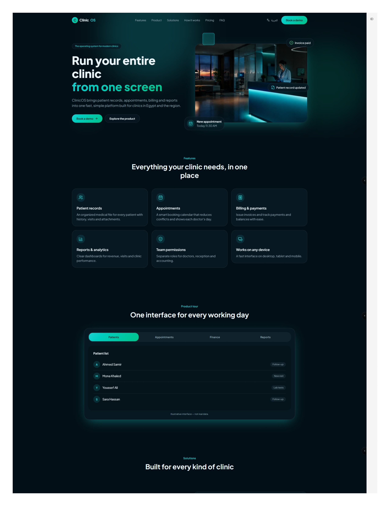

# ClinicOS — Landing Page

A bilingual (English / Arabic) dark-theme landing page for **ClinicOS**, a clinic management platform for practices in Egypt and the region. Built with React, Vite and Tailwind CSS, with full right-to-left support.



---

## Features

- **Bilingual EN / AR** — every string lives in one content file; switching the language flips `dir` on `<html>` and the whole layout mirrors.
- **True RTL support** — mirrored navigation, flipped arrow icons, logical `start`/`end` spacing instead of hard-coded left/right, and an Arabic font stack (Tajawal).
- **Nine sections** — sticky navbar, hero, features grid, tabbed product tour, solutions, three-step flow, pricing, FAQ accordion, footer.
- **Accessible by default** — real `tablist`/`tabpanel` semantics with arrow-key navigation, `aria-expanded` accordions, visible focus rings, and `prefers-reduced-motion` handling.
- **Responsive** — single-column on mobile with a slide-down menu, up to a six-card grid on desktop.
- **No backend** — a static build you can host anywhere.

---

## Tech stack

| Layer | Choice |
| --- | --- |
| Framework | React 18 |
| Build tool | Vite 5 |
| Styling | Tailwind CSS 3 |
| Icons | lucide-react |
| Fonts | Poppins (Latin), Tajawal (Arabic) |

---

## Getting started

Requires Node.js 18 or newer.

```bash
git clone https://github.com/<your-username>/clinicos-landing.git
cd clinicos-landing
npm install
npm run dev
```

The dev server runs at <http://localhost:5173>.

### Scripts

| Command | What it does |
| --- | --- |
| `npm run dev` | Start the dev server with hot reload |
| `npm run build` | Build the production bundle into `dist/` |
| `npm run preview` | Serve the production build locally |

---

## Project structure

```
clinicos-landing/
├── docs/                     Reference screenshots of the original design
├── public/
│   └── favicon.svg
├── src/
│   ├── components/
│   │   ├── Navbar.jsx        Sticky header, mobile menu, language switch
│   │   ├── Hero.jsx          Headline, CTAs, floating notification chips
│   │   ├── HeroVisual.jsx    SVG stand-in for the hero photograph
│   │   ├── Features.jsx      Six-card feature grid
│   │   ├── ProductTour.jsx   Tabbed mock interface (Patients / Appointments / …)
│   │   ├── Solutions.jsx     Two-column clinic types
│   │   ├── HowItWorks.jsx    Three-step onboarding flow
│   │   ├── Pricing.jsx       Bronze / Gold / Diamond plans
│   │   ├── FAQ.jsx           Accordion
│   │   ├── Footer.jsx
│   │   ├── Reveal.jsx        Fade-up-on-scroll wrapper
│   │   └── SectionHeading.jsx
│   ├── data/
│   │   └── content.js        All copy, EN and AR side by side
│   ├── lib/
│   │   ├── i18n.jsx          Language context, dir switching, persistence
│   │   └── icons.jsx         Name → icon registry
│   ├── App.jsx
│   ├── main.jsx
│   └── index.css             Tailwind layers and design tokens
├── index.html
├── tailwind.config.js
└── vite.config.js
```

---

## Editing the content

All copy is in [`src/data/content.js`](src/data/content.js), keyed by locale. Each section has an `en` and an `ar` entry with the same shape, so a missing translation is obvious at a glance.

```js
pricing: {
  plans: [
    { name: 'Bronze', price: '999', regular: '1,499 EGP', features: [...] },
  ],
}
```

No component hard-codes a string, so you can rewrite the whole page without touching JSX.

### Adding a language

1. Add a third key (for example `fr`) to `content` with the same shape and `dir: 'ltr'`.
2. In `src/lib/i18n.jsx`, replace the two-way `toggle` with a selector over `Object.keys(content)`.

---

## Theming

Colors, shadows and animations are defined in [`tailwind.config.js`](tailwind.config.js):

| Token | Value | Used for |
| --- | --- | --- |
| `ink-900` | `#04100f` | Page background |
| `ink-800` | `#061916` | Cards, floating chips |
| `mint-400` | `#2ee6b0` | Primary accent, icons, links |
| `aqua` | `#38d8e0` | Gradient end stop |

Reusable classes (`.btn-primary`, `.surface`, `.section-title`, `.eyebrow`) live in the `@layer components` block of `src/index.css`.

---

## Using a real hero image

`HeroVisual.jsx` draws an SVG illustration of a clinic reception so the repo ships without binary assets. To use a photograph, drop it in `public/` and replace the component's body:

```jsx
export default function HeroVisual({ alt }) {
  return 
}
```

---

## Changes from the original mock-up

This implementation fixes four issues present in the design it was rebuilt from:

1. **Arabic pricing cards were clipped** — plan names, the "most popular" badge and the prices were cut off at the card's top edge. The grid now reserves space for the badge, and cards stretch to equal height.
2. **Prices differed between languages** — the Arabic version showed different figures from the English one. Both locales now read from the same numbers.
3. **The "How it works" eyebrow was missing in Arabic** — it is now a translated key like every other label.
4. **The Solutions section rendered half-empty** — the opposite column was blank for a full screen height. It now carries the section copy and two supporting stats.

---

## Deployment

The build output in `dist/` is fully static.

**Vercel / Netlify** — build command `npm run build`, publish directory `dist`.

**GitHub Pages** — `vite.config.js` already sets `base: './'`, so relative asset paths work from a project subpath:

```bash
npm run build
npx gh-pages -d dist
```

---

## License

MIT — see [LICENSE](LICENSE).

The reference screenshots in `docs/` are included for comparison only.
